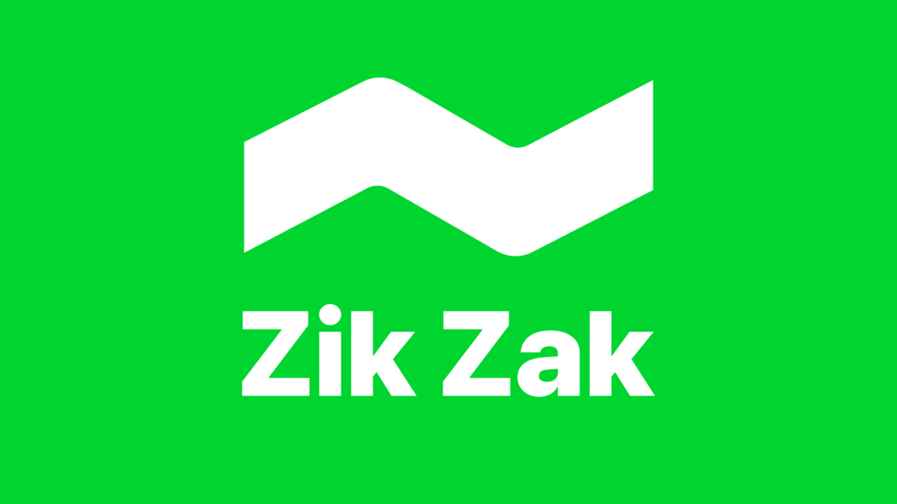

<!-- ZURAFFA-LAUNCH-PROMO (valid until Dec 1, 2026) -->
## 🦒 [Zuraffa Browser](https://zuraffa.com) — now live

<div align="center">
  <a href="https://zuraffa.com"></a>
</div>

**[Zuraffa Browser](https://zuraffa.com)** — the multi-tasking browser for AI agents & humans — is live on the [Mac App Store](https://apps.apple.com/app/id6811352058).

🎁 **Launch offer: 6 months free with code `ZURAFFA`** — no credit card, no subscription, no payment. Redeem in-app until **Dec 1, 2026**.

---

# Zorphy

**Zorphy** is a powerful code generation package for Dart/Flutter that provides clean, immutable class definitions with advanced features including copyWith methods, JSON serialization, equality, toString, inheritance support, and sophisticated patch mechanisms.

## Sponsor

[](https://zuzu.dev) [](https://zuzu.dev)

Thanks to ZikZak AI for sponsoring this project!

ZikZak AI is an AI-Powered Price Comparison app that you scan barcodes, and discover amazing savings instantly. Your personal shopping assistant that never sleeps.

<a href="https://apps.apple.com/tr/app/zik-zak/id1563425450"></a>
<a href="https://play.google.com/store/apps/details?id=dev.zuzu.zingo"></a>

## 📖 Documentation

Visit the official documentation at **[arrrrny.github.io/zorphy](https://arrrrny.github.io/zorphy/)** for detailed guides, examples, and API references.

You can also find the package on **[pub.dev](https://pub.dev/packages/zorphy)**.

## ✨ Features

Zorphy v3 is a zero-preset code generator. A class is annotated with exactly
**one of five archetypes** that names what the class IS — there are no
`preset:` or `generate*` toggles to keep in sync.

- 🧬 **Five archetypes** — `@ZorphyEntity`, `@ZorphyValue`, `@ZorphyUnion`,
  `@ZorphyState`, `@ZorphyIntent`
- 🔄 **CopyWith & patches** — every archetype gets a `<Name>Patch` with
  `diff` / `apply`, `compose` / `invert`, and `changedPaths` / `conflictingPaths`
  for three-way sync
- 📦 **Wire codecs** — `toWire()` / `fromWire()` replace the legacy JSON codecs;
  `fromWire` decodes untrusted data at a trust boundary and returns a
  `ZorphyBoundaryResult<T>` instead of leaking a raw `TypeError`
- 🔐 **Sealed unions & open hierarchies** — declarative polymorphism via a
  `discriminator` field and `explicitSubTypes`, with exhaustive Dart 3 `switch`
- 🏷️ **Reflection-free descriptor** — `Entity.descriptor` is a
  `ZorphyEntityDescriptor<T>` exposing `Field<E, T>` selectors, the principal
  key, `diff`, and the wire codec — valid under Dart AOT (no `dart:mirrors`)
- 🔎 **Filter/query descriptors** — `Field<E, T>` selectors plus `eq` / `gt` /
  `lt` / `contains` / `and` / `or` / `sort` helpers
- 🧱 **Generics & polymorphism** — generic classes carry their type arguments
  through the wire codecs; codec-parameterized `toWire` / `fromWire` close the
  generic boundary
- 🤖 **AI-Friendly CLI & MCP server** — scaffold and manage entities from an
  agent or the command line
- ⚖️ **Equality, `toString`, enums, self-referencing types** — generated for you

## ⚖️ Zorphy vs Freezed

Both generate immutable data classes. Zorphy goes further — it is a full
**entity toolkit** with a nested patch system, a reflection-free descriptor,
filter/query selectors, and an AI-agent CLI/MCP server.

| Capability | zorphy 3.0 | freezed 3.2.5 |
| --- | --- | --- |
| Immutable data classes | ✅ | ✅ |
| CopyWith | ✅ `copyWith` + field-selector `copyWithField` | ✅ |
| Wire codecs + polymorphic discriminators | ✅ `toWire` / `fromWire` | ✅ (JSON only) |
| Sealed unions | ✅ `@ZorphyUnion()` + Dart 3 pattern matching | ✅ via `when`/`map` helpers |
| **Nested patch system** (partial updates of deep graphs) | ✅ `UserPatch.diff(a, b).apply(user)` | ❌ manual nested copyWith chains |
| **Reflection-free descriptor** (`Entity.descriptor`) | ✅ `ZorphyEntityDescriptor<T>` | ❌ |
| **Filter/query selectors** (`Field<E, T>`) | ✅ | ❌ |
| **Patch algebra** (`changedPaths` / `conflictingPaths` / `compose`) | ✅ | ❌ |
| Multiple interface inheritance with generics | ✅ | ❌ |
| Self-referencing types | ✅ | ✅ |
| CLI + MCP server for scaffolding | ✅ | ❌ |
| analyzer 14 support | ✅ `>=13.0.0 <15.0.0` | ❌ caps `analyzer <11.0.0` (as of 2026-07-30) |

**Where freezed differs (honest notes):** freezed's mixin pattern
(`with _$Foo`) keeps the annotated class itself concrete; zorphy uses
`abstract class $Foo` + generated `Foo`. freezed's `when`/`map` helpers
are answered in zorphy by Dart 3's native exhaustive `switch` on the
sealed base. Freezed's ecosystem is older and larger.

### Side by side

**1. Simple value class** — freezed:

```dart
@freezed
class User with _$User {
  const factory User({required String id, required String name, String? email}) = _User;
  factory User.fromJson(Map<String, dynamic> json) => _$UserFromJson(json);
}
```

zorphy (a `@ZorphyValue` — an immutable value object with no identity):

```dart
@ZorphyValue()
abstract class $User {
  String get id;
  String get name;
  String? get email;
}
```

**2. Sealed union** — freezed:

```dart
@freezed
class Result with _$Result {
  const factory Result.ok(String value) = Ok;
  const factory Result.err(String message) = Err;
}
```

zorphy (a real sealed `@ZorphyUnion()` with redirecting variant factories,
exhaustive Dart 3 switch):

```dart
@ZorphyUnion()
abstract class $Result {
  factory $Result.ok(String value) = $Ok;
  factory $Result.err(String message) = $Err;
}

@ZorphyValue()
class $Ok implements $Result {
  final String value;
  const $Ok(this.value);
}

@ZorphyValue()
class $Err implements $Result {
  final String message;
  const $Err(this.message);
}

String describe(Result r) => switch (r) {
  Ok(:final value) => 'ok: $value',
  Err(:final message) => 'err: $message', // exhaustive — no default needed
};
```

**3. Nested partial update** — freezed requires manual deep copyWith:

```dart
user.copyWith(address: user.address.copyWith(city: 'Berlin'));
```

zorphy's patch system composes:

```dart
final patch = ProfilePatch.diff(before, after); // carries a nested AddressPatch
final updated = patch.apply(profile);
```

**Migrating from freezed?** Use the
[`zorphy_migrator`](zorphy_migrator/) codemod:

```bash
dart pub global activate zorphy_migrator
zorphy_migrator migrate lib/ --dry-run    # preview unified diff
zorphy_migrator migrate lib/ --apply --report MIGRATION.md
```

It converts simple classes, sealed unions, `@Default`, `@JsonKey`, and
fromJson/toJson automatically, and reports anything that needs human
attention with `file:line` — nothing is silently dropped. See the
[migration guide](https://arrrrny.github.io/zorphy/docs/migrating-from-freezed).

## 📦 Installation

Add the dependencies to your `pubspec.yaml`:

```yaml
dependencies:
  zorphy_annotation: ^3.0.0-dev.4

dev_dependencies:
  zorphy: ^3.0.0-dev.4
  build_runner: ^2.4.0
```

Install the CLI globally:

```bash
dart pub global activate zorphy
```

## 🚀 Quick Start

Declare a class with one archetype, run the generator, then use the generated
class (the `$`-prefix is dropped in the output).

```dart
import 'package:zorphy_annotation/zorphy_annotation.dart';

// zorphy 3.0 emits a shared part under lib/_br_/ and build_runner writes the
// `part` directive for you — there is nothing to declare here.

@ZorphyValue()
abstract class $User {
  String get name;
  int get age;
  String? get email;
}
```

Run the generator:

```bash
dart run build_runner build
```

Use the generated class:

```dart
void main() {
  final user = User(name: 'Alice', age: 30);

  // Copy with changes
  final olderUser = user.copyWith(age: 31);

  // Wire codec (replaces the legacy JSON codec)
  final wire = user.toWire();
  final fromWire = User.fromWire(wire); // ZorphyBoundaryResult<User>
}
```

### Choosing an archetype

| Archetype | Use it for |
| --- | --- |
| `@ZorphyEntity(principalKey: #id)` | an aggregate/event root with its own identity |
| `@ZorphyValue()` | an immutable value object with no identity |
| `@ZorphyUnion()` | a closed discriminated union of sibling variants |
| `@ZorphyState()` | a mutable/composed state node in a sealed hierarchy |
| `@ZorphyIntent(replaySafe: true)` | a replay-safe command/intent envelope |

Polymorphism is declarative: name the wire `discriminator` (default `'kind'`)
and list any subtypes the generator cannot infer with `explicitSubTypes`.
See the [website docs](https://arrrrny.github.io/zorphy/) for the full guide to
every archetype, the patch system, the descriptor, filters/queries, generics,
and the CLI/MCP tooling.

## 🤖 CLI & MCP

The Zorphy CLI scaffolds and builds entities, and the same surface is exposed
as a Model Context Protocol server for AI agents.

```bash
# Create an entity with fields
zorphy create -n Product --field name:String --field price:double

# Build all entities (clean + watch supported)
zorphy build
zorphy build --watch

# List entities
zorphy list
```

The MCP server (`zorphy_mcp_server`, registered by `dart pub global activate
zorphy`) exposes `create_entity`, `create_enum`, and `add_field` tools. The full
CLI and MCP reference lives on the
[website](https://arrrrny.github.io/zorphy/).

## 🏗️ Build Configuration

By default, Zorphy runs as part of the build process. The builder is configured in `build.yaml`:

```yaml
targets:
  $default:
    builders:
      zorphy:zorphy:
        enabled: true
```

Run the generator:

```bash
# Build once
dart run build_runner build

# Build and watch for changes
dart run build_runner watch

# Clean generated files
dart run build_runner clean

# Or use the CLI
zorphy build
zorphy build --watch
zorphy build --clean
```

## 📝 Naming Conventions

### Class Prefixes

- **`$ClassName`** - Concrete class definition (use `ClassName` in code)
- **`ClassName$`** - Enum of field names for the patch system
- **`ClassNamePatch`** - Patch class for partial updates

### Generated Files

- **`lib/_br_/**.part.dart`** - Generated code from the archetype annotations,
  one shared part per library. As of 3.0 the builder declares
  `adds_to_library: true`, so `build_runner` emits a single
  `<library>.part.dart` per annotated library and inserts the `part`
  directive itself. Delete any hand-written `part '*.zorphy.dart';` line and
  the 2.x `<file>.zorphy.dart` files, then rebuild — or let
  `dart run zorphy:migrate_v3 <path> --apply` do both. Each generated part
  carries `// ignore_for_file:` headers; exclude `lib/_br_/**` from analysis if
  you prefer to keep generated code out of it altogether.
<a id="v3-migration"></a>
## 🔄 Migrating v2 → v3

Zorphy 3.0.0 is a breaking major that drops every legacy preset and
`generate*` toggle and unifies all five zero-preset archetypes
(`@ZorphyEntity`, `@ZorphyValue`, `@ZorphyUnion`, `@ZorphyState`,
`@ZorphyIntent`). Migrate with the bundled codemod — never hand-edit v2
annotations. Before running the codemod, bump `zorphy` and
`zorphy_annotation` to `^3.0.0` (they move in lockstep), then run
`dart pub get`. The `migrate_v3` executable ships with 3.0, not with 2.x.

### v2 → v3 at a glance

| v2 (removed) | v3 (replacement) |
| --- | --- |
| `@Zorphy(...)` / `@Zorphy2(...)` on an `id`-bearing class | `@ZorphyEntity(principalKey: #id)` |
| `@Zorphy(...)` on an `id`-less class | `@ZorphyValue()` |
| `@ZorphySealed(...)` / `$$Base` sealed roots | `@ZorphyUnion()` (closed) / `@ZorphyState()` (composed) |
| every `preset:` / `generate*` argument (`generateJson`, `generatePatch`, `generateCompareTo`, `generateFilter`, `generateCopyWithFn`, `explicitSubTypes`, `nonSealed`, `hidePublicConstructor`, …) | deleted — an archetype names what the class IS; polymorphism is `discriminator` + `explicitSubTypes` on the annotation |
| `copyWith(...)` / `copyWithField(...)` / `copyWithFn(...)` | `ZorphyPatch` — `EntityPatch.diff(before, after).apply(target)` |
| `toJson()` / `fromJson()` / `toJsonLean()` | `toWire()` / `fromWire()` (the v3 wire codecs; no JSON codec is generated) |
| `<Entity>Patch.create()..withX(...)` + `patchWith<Entity>(...)` | `<Entity>Patch.diff(before, after)` + `patch.apply(target)` (`compose` / `invert` / `changedPaths` for three-way sync) |
| `compareTo<Entity>(other)` | `<Entity>.descriptor` + `Field<E, T>` selectors (`ProductFields`-style) and the patch `changedPaths` / `conflictingPaths` |
| `Entity.descriptor` (implicit) | `Entity.descriptor` — a reflection-free `ZorphyEntityDescriptor<T>` (`principalKeyField`, `fields`) |
| hand-written `part '*.zorphy.dart';` + per-file `<file>.zorphy.dart` | one shared `<library>.part.dart` under `lib/_br_/`; `build_runner` inserts the `part` directive |
| `dart run build_runner build --delete-conflicting-outputs` | `dart run build_runner build` (the flag was removed in build_runner 2.17) |

### Codemod

```bash
dart run zorphy:migrate_v3 <path>          # dry-run preview
dart run zorphy:migrate_v3 <path> --apply  # rewrite in place
```

It strips every `preset:` / `generate*` argument and emits the zero-preset v3
archetypes plus the `fromWire` / `toWire` codecs. After migrating:

1. Delete the 2.x `<file>.zorphy.dart` files and any hand-written
   `part '*.zorphy.dart';` line — 3.0 emits one shared `<library>.part.dart`
   under `lib/_br_/` and `build_runner` inserts the `part` directive itself.
2. Run `dart run build_runner build` to regenerate the shared parts.

The v3 wire codecs (`fromWire` / `toWire`) replace the legacy
`fromJson` / `toJson`; generated output no longer emits JSON codecs.

## 🔄 Migration from Morphy

Zorphy is designed for easy migration from Morphy:

1. Replace `@Morphy` with `@Zorphy`
2. Replace `morphy_annotation` dependency with `zorphy_annotation`
3. Replace `zikzak_morphy` dependency with `zorphy`
4. Run `dart run build_runner clean`
5. Run `dart run build_runner build`

**Key Differences:**

- Better patch system with nested support
- Enhanced generic handling
- Improved error messages
- More flexible inheritance patterns
- Built-in CLI and MCP server for AI agents

## 🐛 Troubleshooting

### Type Not Found Errors

If you get type not found errors, ensure:

1. You've run `dart run build_runner build` (or `zorphy build`) so the shared
   part under `lib/_br_/` is regenerated — no `--delete-conflicting-outputs`:
   build_runner 2.17 removed that flag and only warns about it
2. You removed any leftover `part 'filename.zorphy.dart';` line and any stale
   `filename.zorphy.dart` from the 2.x layout — 3.0 no longer writes per-file
   generated libraries, and `build_runner` adds the shared-part directive
   itself; `dart run zorphy:migrate_v3 <path> --apply` strips the directives
   and deletes the stale files for you
3. The import includes `package:zorphy_annotation/zorphy_annotation.dart`

### Generic Type Issues

When using generics, ensure type parameter names match between parent and child:

```dart
// ✅ Correct - Same generic name
abstract class $A<T> { }
abstract class $B<T> implements $A<T> { }

// ❌ Wrong - Different generic names
abstract class $A<T1> { }
abstract class $B<T2> implements $A<T1> { }
```

### Circular Dependencies

The v3 generator resolves build order automatically from the archetype
annotations — there is no build-order annotation to declare, and no
`@Zorphy2` to migrate. Declare each class with its archetype and run
`dart run build_runner build`.

## License

MIT License - see LICENSE file for details

## Acknowledgments

Inspired by and designed to improve upon the Morphy code generation package.

---

**Made with 🔥 by the ZikZak AI team for the community and AI agents**
